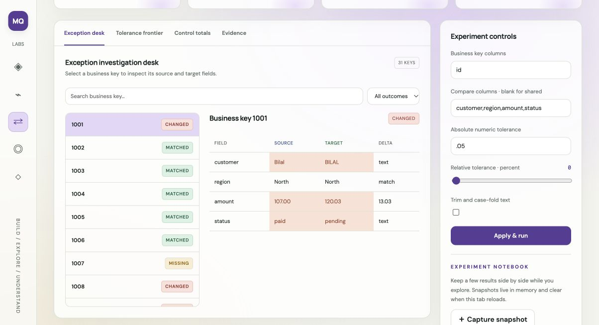

<p align="center"><a href="https://m-qazi99.github.io/recon-lab/"></a></p>
<p align="center"><a href="https://m-qazi99.github.io/recon-lab/"><strong>Launch live product ↗</strong></a> · <a href="docs/USER_GUIDE.md">User guide</a> · <a href="docs/API.md">API reference</a> · <a href="CONTRIBUTING.md">Contribute</a></p>
<p align="center"></p>

# Recon Lab

Compare source and target records using unique business keys and explicit tolerance policies. An independent, open-source Python application by **[Muzammil Qazi](https://m-qazi99.github.io/profile/)**, with a browser workspace, native CLI, local API, synthetic examples and automated tests.

## What's new in 2.1

**Review Desk turns computed evidence into an inspectable handoff.** Keyset exceptions, field-level mismatch priorities, and policy review before widening tolerance. Filter priorities, check what you inspected, and export a Markdown handoff. The checks remain in memory and reset with each new experiment. No inputs are changed and no operational actions are executed.

[Release notes](CHANGELOG.md) · [Architecture](docs/ARCHITECTURE.md) · [Contributing](CONTRIBUTING.md) · [Project comparison](https://m-qazi99.github.io/project-guide/)

<a href="https://m-qazi99.github.io/recon-lab/"></a>

## Try a complete workflow

Run the sample → inspect changed records → compare tolerance frontier → review missing keys → open Review desk → export the handoff.

The first screen is explicitly labeled **synthetic preview**. Choose **Run experiment** to compute your inputs using Python. The runtime downloads on first use; there is no analysis server or account.

## What the code does

The engine indexes unique composite keys and compares shared fields using Decimal arithmetic. A numeric field matches when delta ≤ max(absolute tolerance, relative percentage × absolute source value). Text trimming/case-folding is opt-in. A sensitivity sweep recomputes match coverage over seven absolute tolerance settings.

The new `src/review.py` derives deterministic priorities from the result, then adds `review-handoff.md` and `review-priorities.json`. JavaScript renders these Python findings; it does not reimplement the analytical rules.

## Run locally

Python 3.11+; no third-party Python packages required.

```bash
git clone https://github.com/m-qazi99/recon-lab.git
cd recon-lab
python server.py
```

Open http://127.0.0.1:8000. The UI uses the same browser worker as the public product; the local API runs native Python.

```bash
# Native Python, no browser runtime required
python src/cli.py < examples/studio.json

# Tests and native/browser source parity
python -m unittest discover -s tests -v
python scripts/check_site.py

# Regenerate the labeled preview after changing Python
python scripts/build_preview.py
```

See [API examples and request fields](docs/API.md). The legacy request in `examples/sample.json` remains supported; `workspace: "studio"` selects the advanced workspace.

## Repository map

| Path | Responsibility |
|---|---|
| `src/engine.py` | Stable request routing; preserves the original API |
| `src/lab.py` | Project-specific analytical engine |
| `src/review.py` | Deterministic priorities and handoff artifacts |
| `src/cli.py`, `server.py` | Native command line and loopback HTTP API |
| `docs/` | GitHub Pages app, pinned worker runtime and Python copies |
| `docs/review-desk.js` | Priority filters, inspection checklist and handoff export |
| `examples/` | Synthetic input fixtures |
| `tests/` | Engine, review-policy and regression tests |
| `scripts/` | Preview generation and deployment parity checks |

## Scope and limitations

Missing and target-only keys are unaffected by numeric tolerances. Control totals cover entire input snapshots and can include numeric identifiers. Equal totals do not prove equal records. Data is never repaired or written back.

Inputs remain in the active tab. Initial runtime files come from jsDelivr and fonts from Google Fonts; no input is sent to these services. Inputs and snapshots are not automatically persisted. Exported experiments include their input; review before sharing. File contents are limited to 2 MB and CSV datasets to 10,000 rows.

Review priorities are deterministic prompts, not an LLM diagnosis. Checking every item does not certify correctness, privacy, safety or production readiness. The reviewed handoff records the visitor's checklist state; it is not an independent approval.

## Open-source participation

Start with [CONTRIBUTING.md](CONTRIBUTING.md), the [development guide](docs/DEVELOPMENT.md), and [roadmap](ROADMAP.md). Report reproducible bugs using synthetic inputs. Changes should include relevant policy-boundary tests and keep browser/native Python copies aligned. [MIT license](LICENSE); [security reporting](SECURITY.md).

**Technical areas:** source-to-target reconciliation, composite keys, Decimal arithmetic, tolerance policy, exception ledger, control totals, Pyodide, WebAssembly, Web Workers, accessible UI, Python CLI, local HTTP API, test-driven maintenance.

Built with Codex assistance as independent portfolio work. Public examples do not establish employer deployment, client outcomes or production adoption.

[Live product](https://m-qazi99.github.io/recon-lab/) · [Portfolio](https://m-qazi99.github.io/) · [All projects](https://m-qazi99.github.io/projects/) · [Contact](https://m-qazi99.github.io/contact/)
