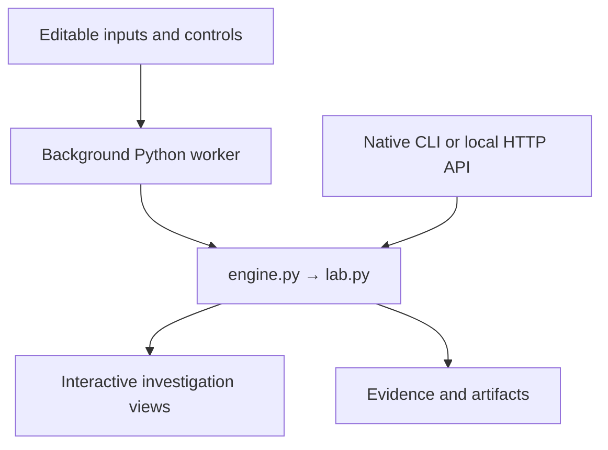

<p align="center"><a href="https://m-qazi99.github.io/recon-lab/"></a></p>
<p align="center"><a href="https://m-qazi99.github.io/recon-lab/"><strong>Launch the interactive studio ↗</strong></a> · <a href="#run-locally">Run Python locally</a> · <a href="docs/ARCHITECTURE.md">Architecture</a> · <a href="tests/test_studio.py">Tests</a></p>
<p align="center">  </p>

# Recon Lab Studio

**A reconciliation desk, not just a row-count check.**

Move beyond row counts. Investigate field-level differences, model tolerance policies, and trace every exception to its source.

## Explore the product

Run **Mixed exceptions** → choose a business key → inspect changed fields → explore **Tolerance frontier** → click a tolerance bar → compare **Control totals**.

| Capability | What you can inspect |
|---|---|
| Selectable record diff inspector | Python-computed results, accessible controls, and exportable evidence |
| Absolute and relative Decimal policies | Python-computed results, accessible controls, and exportable evidence |
| Tolerance sensitivity frontier | Python-computed results, accessible controls, and exportable evidence |
| Control totals and exception ledger | Python-computed results, accessible controls, and exportable evidence |

The interface includes three synthetic scenarios, four workspace views, light multicolor themes, editable inputs, local file loading, in-memory experiment snapshots, keyboard shortcuts, and downloadable artifacts. The **input editor** exposes the real experiment rather than hiding the model behind a decorative dashboard.

## Python mechanics

The engine indexes unique composite keys and compares shared fields using Decimal arithmetic. A numeric field matches when delta ≤ max(absolute tolerance, relative percentage × absolute source value). Text trimming/case-folding is opt-in. A sensitivity sweep recomputes match coverage over seven absolute tolerance settings.

## Run locally

No Python packages are required. Use Python 3.11 or newer.

```bash
git clone https://github.com/m-qazi99/recon-lab.git
cd recon-lab
python server.py
```

Open **http://127.0.0.1:8000**. The local server exposes the native Python API; the web UI uses the browser worker so its behavior matches the public demo. The public site requires a modern browser with WebAssembly and access to the runtime CDN.

```bash
# Native Python CLI: no browser, CDN, or third-party packages
python src/cli.py < examples/studio.json

# Native Python HTTP API
curl -s http://127.0.0.1:8000/api/analyze \
  -H 'Content-Type: application/json' \
  --data-binary @examples/studio.json

# Engine, boundary, and regression tests
python -m unittest discover -s tests -v
python scripts/check_site.py
```

`examples/studio.json` is the complete version-2 experiment request. The `workspace: "studio"` field selects the advanced engine in `src/lab.py`. The original version-1 API remains available through `examples/sample.json` for compatibility. Errors return HTTP 400 with an `error` message; successful requests return metrics, evidence, artifacts, and a structured `lab` object for visualization.

## Architecture



- `src/lab.py` — the advanced, dependency-free Python computation.
- `src/engine.py` — explicit version routing and original API compatibility.
- `docs/lab.py`, `docs/engine.py`, `docs/common.py` — byte-identical browser copies, checked by CI.
- `docs/studio.js` — rendering, interaction, worker lifecycle; no duplicate analytical algorithm.
- `docs/worker.js` — pinned Pyodide 0.27.7 runtime in a Web Worker.
- `tests/` — **21 automated tests**, including scenario boundaries and regressions.
- `.github/workflows/tests.yml` — tests and browser/native source parity on each push.

## Scope and limitations

Missing and target-only keys are unaffected by numeric tolerances. Control totals cover entire input snapshots and can include numeric identifiers. Equal totals do not prove equal records. Data is never repaired or written back.

Inputs remain in the active tab. Initial runtime files come from jsDelivr and fonts from Google Fonts; no input is sent to these services. Inputs and snapshots are not automatically persisted. Exported experiments include their input; review before sharing. File contents are limited to 2 MB and CSV datasets to 10,000 rows.

## Design and research

This studio is an independent implementation by **Muzammil Qazi**, developed with Codex assistance as a portfolio engineering project. Synthetic scenarios demonstrate the algorithms; they are not employer deliverables or evidence of production adoption. See [design decisions](docs/ARCHITECTURE.md) and [research references](docs/RESEARCH.md).

[Portfolio](https://m-qazi99.github.io/) · [GitHub](https://github.com/m-qazi99) · [MIT](LICENSE)
